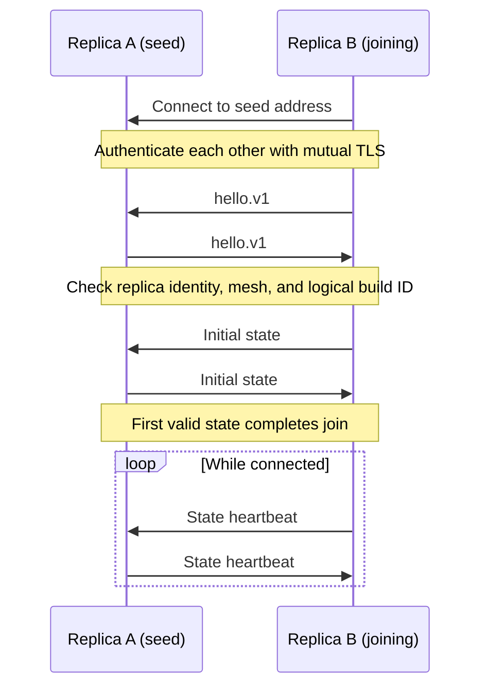
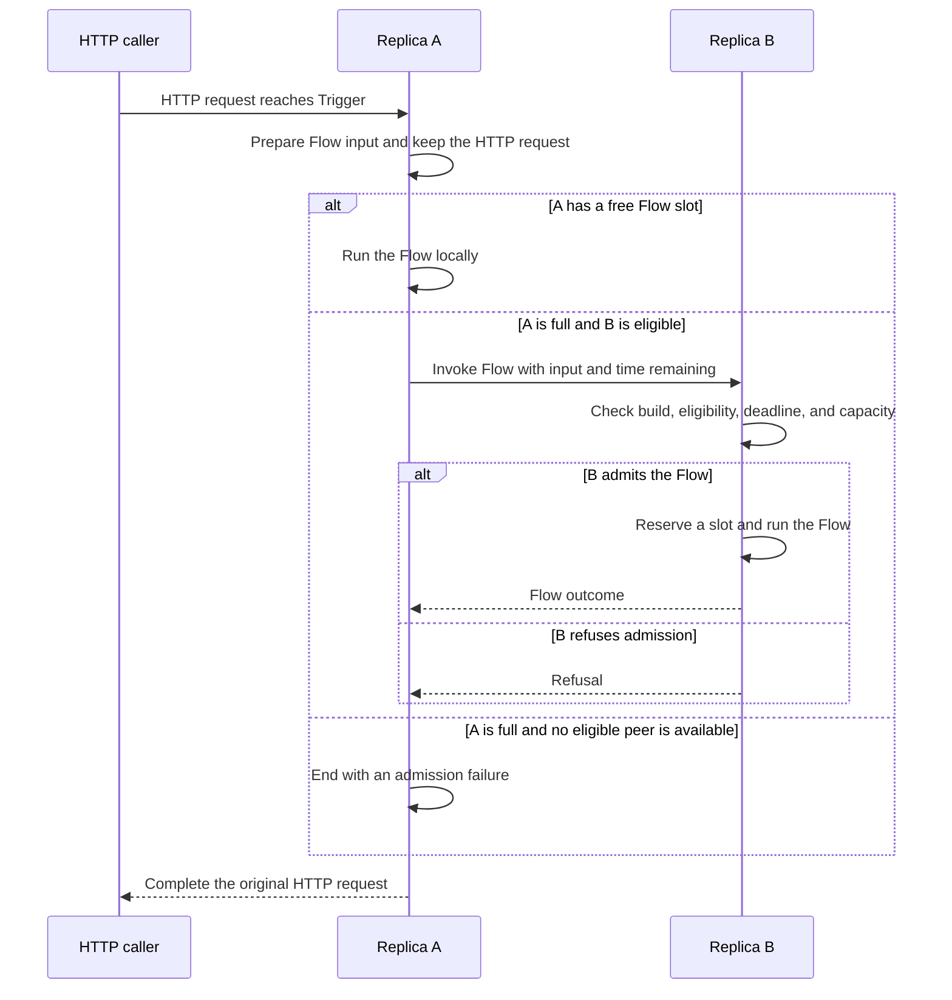

# Railix Mesh

A replica is a running copy of a built Railix application. Replicas of the same logical build can
authenticate each other over mutual TLS and report their connection in Creator. The current demo
joins two replicas at fixed addresses. Multi-peer discovery and Flow offload are planned.

## How It Works

### Join And Track Peers

A **seed** is a configured address a replica tries when joining. Here, B joins through A.



State carries readiness and the advertised mesh address. An identity or build mismatch closes
the connection before state is exchanged. A disconnect or heartbeat timeout removes the peer.
Failed attempts to a configured seed are retried with backoff.

The original seed can leave once the remaining replicas are connected and new replicas have
another reachable bootstrap address. With planned automatic discovery, replicas can learn more
peer addresses and authenticate each one directly.

### Run A Flow (Planned)

The replica whose Trigger receives the event owns the original request and sends the response.
It runs the Flow locally when it has a free slot. When full, it can ask a ready, eligible peer.



After a refusal, A can try another eligible peer within the original deadline and attempt limit.
If B may already have admitted the Flow and the connection drops, A reports uncertain completion
and stops retrying.

The first offload test will send an HTTP request directly to a replica. For a stable public URL
across replica changes, deployment can put an HTTP reverse proxy in front of ready replicas.
The proxy routes HTTP requests. Railix tracks its peers and places offloaded Flows.

Later, a mesh-aware client could discover reachable application endpoints and choose a replica
directly. The event would still enter through the same Trigger and follow the same Flow rules.

## Run Two Fixed Peers

From the repository root on macOS or Linux, run the demo with Bash, JDK 25, and `uuidgen`.

```sh
./run-mesh.sh auth-http-app
```

The script builds the application once and starts two loopback replicas with temporary credentials.
`auth-http-app` is the default. You can also pass another directory under `examples/` with a
long-running Trigger, such as `text-normalization-http-app`. Set `RAILIX_CLI_JAR` to reuse an
existing packaged CLI.

Run the printed Creator command in another terminal. Choose **Project actions > Connect live app**
and select either process. In the runtime details, **Mesh** shows the connection state and **Peer**
shows the authenticated peer's readiness. A mismatched build shows **Build mismatch** in the
rejection details. Stop both demo replicas with `Ctrl-C` in the first terminal.

## Deploy An Application

Build once with JDK 25. Copy the printed JAR and [run-mesh.sh](../run-mesh.sh) to each host.
Use Bash, Java 25, and `unzip` to start each replica with its own mesh configuration.

```sh
PROJECT_FILE=path/to/railix.project.json ./run-mesh.sh build

APPLICATION_JAR=/path/to/application.jar RAILIX_MESH_CONFIG=/path/to/mesh.json \
  ./run-mesh.sh deploy
```

You can also build with `railix build railix.project.json --mesh --include-project`. The
`--include-project` option embeds the project documents for Creator attachment. Use the same
JAR for both replicas. Set `APP` to the path printed by the build or to the path of the copied
JAR on the host where you start it.

```sh
APP=/path/to/application.jar
RAILIX_MESH_CONFIG=/path/to/mesh.json java -jar "$APP"
```

### Startup Configuration

Use the same `meshId` and trust issuer on both replicas. Give each replica its own certificate and
private key. The certificate identifies the replica and its mesh. The configuration also sets the
listen and advertised mesh endpoints, bootstrap addresses, Flow capacity, and the paths to the
identity store, trust store, and password files. See the [configuration reference](specs/mesh.md#startup-configuration)
and [certificate requirements](specs/mesh.md#peer-transport-and-trust).

On one host, give the mesh listeners distinct ports, such as `7401` for A and `7402` for B. Give A
an empty `bootstrapEndpoints` list and give B `[{"host":"127.0.0.1","port":7401}]`. Configure
the application's Trigger listeners independently, for example with an ephemeral HTTP port.
On separate hosts, advertise addresses that the other replica can reach through the deployment's
network or VPN.

The [mesh specification](specs/mesh.md) defines the runtime contract. [ADR 0024](adr/0024-optional-mesh-module-and-peer-channel.md)
explains the architecture. The [roadmap](roadmap.md#7-decentralised-execution-state-sharding-and-replication)
tracks the delivery sequence.
